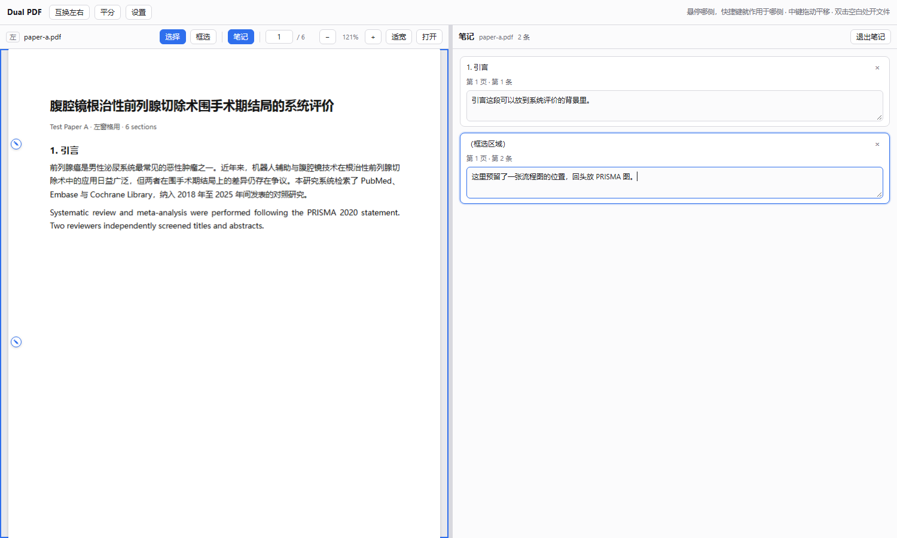

# Dual PDF

左右两个**完全独立**的 PDF 阅读器，一个窗口，两份文档。

- 左边翻页不影响右边，右边缩放不影响左边（没有任何滚动联动）。
- 鼠标悬停哪一侧，快捷键就作用于哪一侧（边框变蓝的那侧是 active）。
- 支持各自缩放、页码跳转、适宽、拖入文件分配、左右互换、分栏拖动。
- 缩放是 Edge 那种连续丝滑的：Ctrl+滚轮 / 触控板捏合，光标下的那一行全程不动。
- 框选放大成镜面、每侧独立的笔记（选句/框选自动成条、气泡定位、Markdown/JSON 导出）。



## 运行

```bash
npm install
npm run dev      # http://127.0.0.1:5178
```

> `npm install` 的 postinstall 会把 pdf.js 的 `cmaps/` 与 `standard_fonts/` 复制到 `public/pdfjs/`（体积大且可再生成，所以没进仓库）。跳过这步的话中文 PDF 的文本层会缺字。
```

生产构建：

```bash
npm run build
npm run preview  # http://127.0.0.1:5179
```

## 用法

| 操作 | 方式 |
| --- | --- |
| 打开 PDF | 拖到左半 / 右半，点「打开」，或在页面旁空白处双击 |
| 一次开两份 | 一次拖两个文件到任意一侧：第一个进被拖的那侧，第二个进另一侧 |
| 笔记模式 | 每侧工具栏里的「笔记」按钮，点哪侧就进哪侧的笔记；面板占另一侧，被记笔记的 PDF 保持可见 |
| 记一条笔记 | 笔记模式下选中文字就自动成条（光标直接落在正文里）；框选一处（图、表格、空白）同样自动成条 |
| 退出笔记 | 再点一次该侧「笔记」按钮，或按 Esc（快捷键可在设置里改） |
| 导出笔记 | 面板右上「导出」→ Markdown（按页列引用+正文）或 JSON（含页码/坐标/时间，方便写脚本） |
| 找笔记 | 点条目、或面板聚焦时 ↑↓ / ←→ 切换，左侧自动滚回对应句子并闪一下 |
| 删笔记 | 卡片右上 ×，或选中条目后按 Delete |
| 选择工具 | `V`（可在设置里改）：左键正常选中文本 |
| 框选工具 | `Z`（可在设置里改）：左键拖一个框，框内区域放大成镜面窗口 |
| 回到原视角 | 点镜面里的「回到原视角」或按 Esc；再按一次工具键（V/Z）或切到另一个工具也会关掉镜面 |
| 移动视图 | 滚轮 / 中键拖动 / PgUp·PgDn / 方向键 —— 选择、框选两种工具下都可用 |
| 改快捷键 | 设置 → 工具键，点一下再按新键（只支持字母，Esc 取消；抢对方的键会自动互换） |
| 翻页 | PgDn / PgUp / 空格 / Shift+空格 / ↑↓，Home / End |
| 缩放 | `+` / `-`，或 Ctrl + 滚轮 / 触控板捏合（只作用于悬停的那侧） |
| 缩放锚点 | 默认保持**视口中心**不动；顶栏「缩放设置」可切成跟随鼠标 |
| 缩放速度 | 顶栏「缩放设置」：步进 3%–30%（默认 11%）、动画 30–250ms（默认 70ms），即时生效并记忆 |
| 适宽 | `0` 或点「适宽」；拖动分隔条时会按新宽度重算 |
| 跳页 | 工具栏页码框输入后回车 |
| 互换左右 | 顶栏「互换左右」 |
| 分栏 | 拖中间分隔条；双击分隔条或点「平分」恢复 50/50 |

## 结构

```
index.html            两栏骨架 + 笔记面板（每个窗格一套工具栏）
src/viewer.js         PdfPane：加载、虚拟渲染、缩放、页码、文本层、框选、气泡
src/notes.js          笔记面板与存储（卡片渲染、方向键导航、localStorage）
src/prefs.js          缩放/快捷键设置
src/main.js           双栏装配、焦点路由、分隔条、拖放、互换、笔记模式
src/style.css         布局 + pdf.js 文本层样式（从 pdf_viewer.css 抄的必要部分）
scripts/copy-pdfjs-assets.mjs  postinstall 把 cmaps / standard_fonts 复制进 public/
test/smoke.mjs        puppeteer 冒烟测试（56 项）
test/fixtures/        paper-a.pdf / paper-b.pdf 测试用
```

## 实现要点

- **笔记是分窗格的**：两边各按自己那份文档的指纹存一套，互不干扰。入口在每侧工具栏里，面板自动占另一侧，所以正在看的那份 PDF 不会被盖掉。
- **两种取词方式，都是自动成条**：选中文字后松手即建条目（光标已在新条目的正文里，直接打字）；拖过无文字的图/空白，或切到框选工具拉一个框，也会把框内文字抓进引用，抓不到字就记成「（框选区域）」。
- **笔记锚点**：气泡记的是「第几页 + 页内 PDF 坐标」，不是像素位置，所以缩放、换栏宽、重新渲染都不会漂；气泡挂在 pages 层里，跟着滚动走，缩放后由 `positionNoteBubbles()` 重算。
- **笔记存储**：按左侧文档指纹（文件名+大小+时间）存 localStorage，两个 PDF 各记各的；正文输入 300ms 防抖落盘。
- **框选放大（镜面）**：框选后按选区的宽高比算出一个窗口，最大占窗格的 80%（不铺满），对同一页用 `viewport(scale=放大倍率)` + `transform` 平移裁剪重渲染，所以是高清而不是拉图片。主视图一像素都不动，「回到原视角」只是关掉这层浮层。
- **丝滑缩放**：Ctrl+滚轮（触控板捏合同理）不直接重排，而是每帧对 `.pages` 做 `transform: scale()`，缩放比例按设置的时间常数指数逼近目标值；手势停下才 destroy + 重排 + 重渲染一次。变换以 0,0 为原点，每帧按「页序号 + 页内比例」反算 `scrollTop/scrollLeft`，所以锚点（默认视口中心，可切鼠标位置）在整段动画和最终重排后都钉在同一处。滚轮一格 = 设置的步进值（默认 11%），触控板给的是细粒度 delta，天然连续。
- **虚拟渲染**：按滚动位置只渲染可见页 ±2，其余销毁（并调 `page.cleanup()` 释放解析缓存），长文档不吃内存。
- **文本层**：用 pdf.js 的 `TextLayer`，摘要、引用、公式编号都能选中复制；CJK 缺 ToUnicode 的文档靠 `cmaps/` 兜底。
- **焦点路由**：document 级 keydown 分派给「active 窗格」，避免按键打给不存在的目标；输入框内不接管按键。
- **各自状态**：每侧自己的 scale / autoFit / 当前页 / 滚动位置；读过的位置按文件指纹（名字+大小+时间）存 localStorage。
- **适宽取众数**：按文档里最常见页宽算缩放，避免一张横向图表页把整篇缩小。

## 测试

```bash
npm run dev                 # 另开一个终端
npm run smoke               # 对着 5178 跑
# 或
$env:DPV_URL='http://127.0.0.1:5179/'; node test/smoke.mjs
```

覆盖：双文档加载、页数独立、canvas 渲染、文本层、滚动互不影响、PageDown 只翻 active 侧、缩放独立、页码跳转、左右互换、分隔条拖动与适宽重算、双击平分、无控制台报错。

## 已知限制

- 不能双击 HTML 文件直接打开（ES module + worker 需要 http），必须用 dev / preview 起服务。
- 笔记导出只包含当前面板（当前那侧文档）的笔记，不含图片。
- 放大镜是框选那一刻的快照：之后再滚动/缩放主视图，镜面内容不变，需要重新框一次。
- 单页超过约 2400 万像素时会自动降采样（canvas 单边上限），超长图纸类 PDF 会略糊。
- 只做阅读：没有批注、书签、搜索、打印。
- 进度记忆只认文件指纹，改名或改时间戳会丢。
